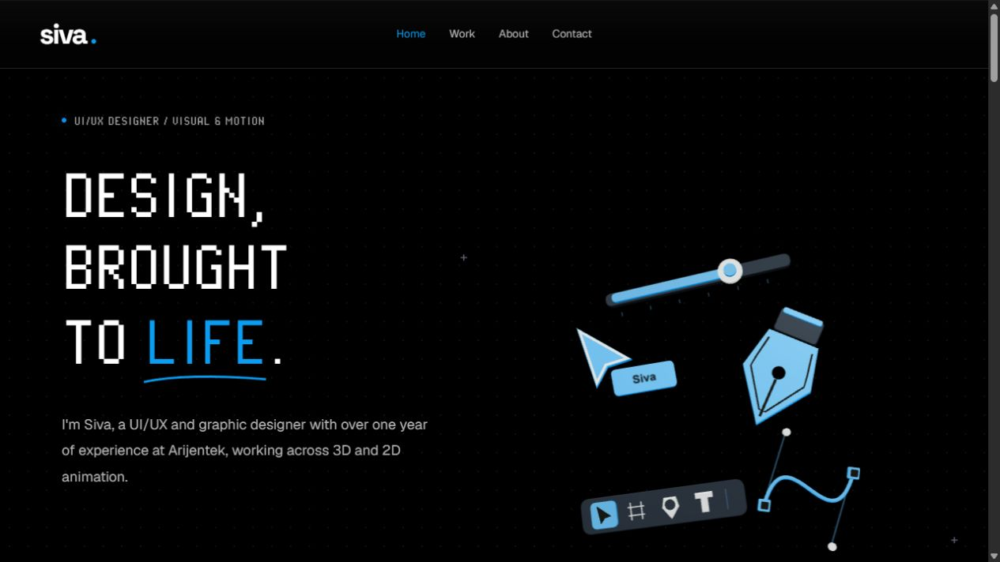

# Siva — Design, brought to life

A responsive portfolio for Siva's UI/UX design, graphic design, 3D animation, and 2D motion work.

[Live website](https://sivanandhabharathi1-sketch.github.io/) · [Source repository](https://github.com/sivanandhabharathi1-sketch/sivanandhabharathi1-sketch.github.io)



## What's included

- Home, Work, About, and Contact pages, each with its own HTML entry.
- A floating Three.js design-tool scene with an SVG fallback and a draggable slider.
- A homepage-only pixel loader with a white loading line.
- Randomized, scroll-driven skill-word reveals in a continuous black introduction.
- A white Experience chapter showing 1+ year at Arijentek, followed by black Projects.
- Animated pixel transitions between chapters, distinct project presentations, and accessible project dialogs.
- A mobile corner menu whose five squares change from a plus to a close icon.
- Native vertical touch scrolling over the 3D scene, reduced-motion fallbacks, and offscreen animation suspension.

## Run locally

Use Node.js 22.12 or newer and pnpm. The package manager version and exact dependencies are recorded in `package.json` and `pnpm-lock.yaml`.

```sh
pnpm install --frozen-lockfile
pnpm dev
```

Open the local address printed by Vite. The default is http://127.0.0.1:5173/.

```sh
pnpm build
pnpm preview
```

## Publish to GitHub Pages

This is a static website. This repository is the account's root Pages site, so Vite's default `/` base and the site's `/work/`, `/about/`, and `/contact/` links resolve correctly.

```sh
pnpm build:pages
```

Commit the updated source and `docs/` output to `main`. In **Settings → Pages**, publish from the `main` branch and `/docs` folder. The included `.nojekyll` keeps the generated static files intact. The `docs/` folder already includes a build, so this copy can be published without installing Node on the host.

For a repository hosted under a subpath instead of the account root, update Vite's base **and** the root-relative page and asset links before deploying.

[GitHub Pages publishing documentation](https://docs.github.com/en/pages/getting-started-with-github-pages/creating-a-github-pages-site) · [Vite deployment documentation](https://vite.dev/guide/static-deploy.html)

## Project structure

```text
src/              React components, styles, Three.js scene, and motion
public/           Project artwork, tool previews, and self-hosted fonts
index.html        Home page entry
work/index.html   Work page entry
about/index.html  About page entry
contact/index.html Contact page entry
scripts/          Build-to-Pages helper
docs/             Publishable static build and asset attribution notes
assets/           Repository preview
```

## Dependencies and network use

React and Vite provide the application and build. Three.js and React Three Fiber render the hero. GSAP/ScrollTrigger and Lenis handle motion. The main pixel and Geist fonts and project images are local. Google Fonts supplies supplementary DM Sans and Space Grotesk faces; local/system fallbacks remain available. External Framer, Behance, social, and email links open the original destinations. No API keys, server, database, or environment variables are required.

## Artwork and attribution

Portfolio artwork and project links were supplied by Siva. The design uses original implementations inspired by supplied visual references, including React Bits and Mosaic; it is not affiliated with those sites. Tool-workspace images are examples from their publishers, not personal project work. Sources and the Blender attribution are recorded in [docs/tool-preview-sources.md](docs/tool-preview-sources.md). Font licenses are included in `public/fonts/` and copied into the Pages build.

No general open-source license has been added to the portfolio code or artwork. Third-party assets retain their respective rights and licenses.
